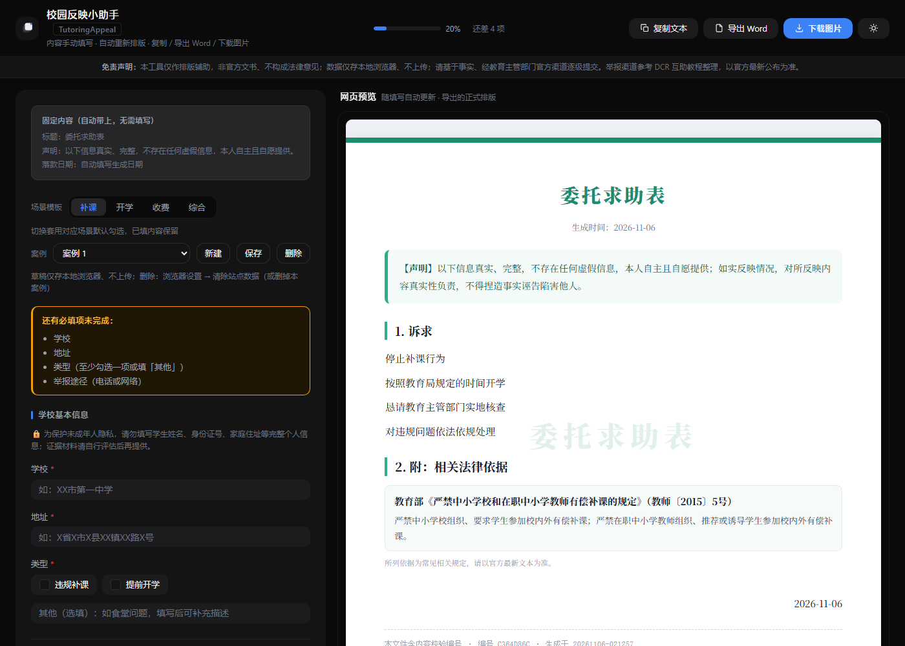

# 校园反映小助手 · TutoringAppeal

一个**纯本地运行**的单文件网页工具，帮你快速填写并自动排版「校园诉求 / 反映表」，
支持多案例草稿、场景模板、一键复制 / 导出 Word / 下载图片 / 打印 PDF。

> ⚠️ **免责声明**
> 本工具仅作排版辅助，**非官方文书、不构成法律意见**；所有内容由你本人填写并对真实性负责；
> 数据仅保存在你本机的浏览器（localStorage），**不上传任何服务器**；
> 请基于事实、经教育主管部门官方渠道逐级提交。举报渠道参考 DCR 互助教程整理，以官方最新公布为准。

## 功能

- **场景模板**：补课 / 开学 / 收费 / 综合，一键套用对应默认勾选
- **多案例草稿**：本地保存多个案例，随时切换 / 新建 / 删除
- **实时预览**：右侧边填边排版，所见即所得
- **导出**：复制文本 / 导出 Word(.doc) / 下载图片(.png) / 打印 PDF
- **深色 / 浅色**主题切换
- **移动端适配**：手机单栏、底部固定操作栏
- **附录资料**：法规依据默认不勾选、按需选择；建议附带材料清单
- **举报途径**：12345（区号+12345）、国务院小程序、领导留言板、各省规范办学行为举报平台（选省份显示电话/网址/邮箱）

## 使用

直接双击 `index.html`，用任意现代浏览器打开即可——**无需联网、无需安装**。
（`wtb.html` 与 `index.html` 内容相同，保留原文件名供本地使用。）

## 打包为 Android App

`dist/校园反映小助手.apk` 为已签名的 WebView 壳应用（minSdk 21 / targetSdk 28，V1+V2+V3 签名）。
安装后即可在手机上离线使用。

## 隐私

全部数据仅存于浏览器 `localStorage`，不上传任何服务器。
**删除草稿**：清除浏览器站点数据（设置 → 隐私 → 清除站点数据）即可。

## 许可

[MIT](LICENSE)

## 致谢

举报渠道与经验整理参考 [DCR](https://www.dcr2026.com) 互助教程《互助经验及要点》《新人引导文档》。
本工具与 DCR 无隶属关系，不组织、不支持任何举报或行动，仅提供信息参考与排版辅助。
